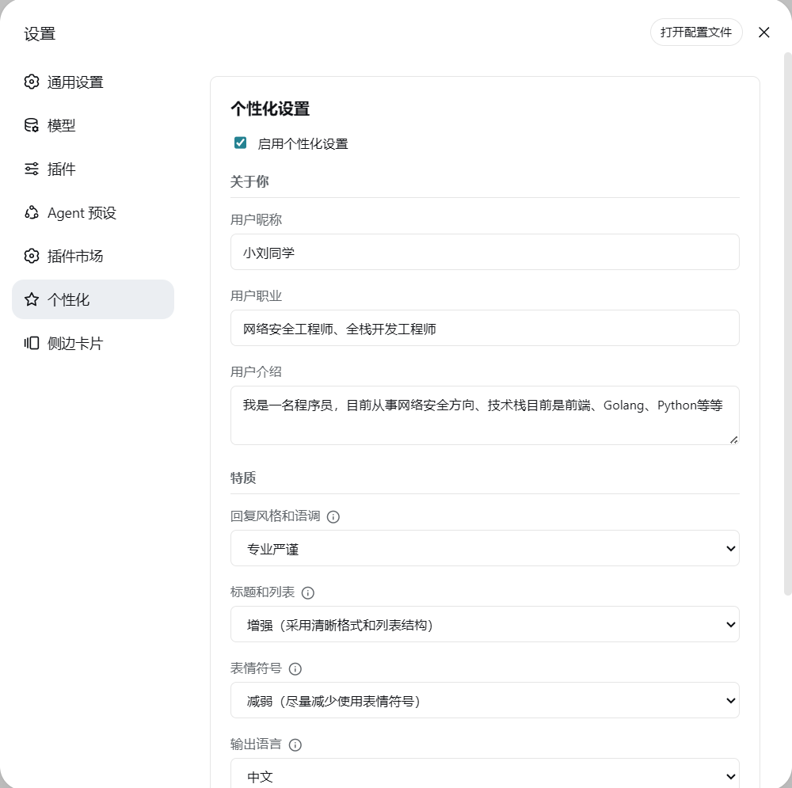
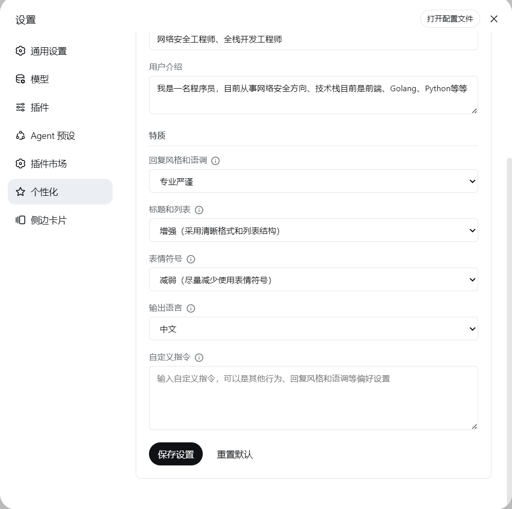

# dsh-soul

[简体中文](./README.md) | [English](./README_EN.md)

[](https://dsh-plugin.org/plugins/aliuyanfeng/dsh-soul)
[](https://hub.xerj.org/contributors/Aliuyanfeng)
[](./LICENSE)
[](https://github.com/Aliuyanfeng/dsh-soul/stargazers)
[](https://github.com/Aliuyanfeng/dsh-soul/issues)
[](https://github.com/Aliuyanfeng/dsh-soul/commits)
[](https://github.com/Aliuyanfeng/dsh-soul)
[](https://github.com/Aliuyanfeng/dsh-soul/actions/workflows/ci.yml)
[](https://www.npmjs.com/package/dsh-soul)
[](https://www.npmjs.com/package/dsh-soul)

DeepSeek Harness 个性化设置插件，用于配置 Agent 的昵称、回复风格、语调和自定义指令。

## 功能

- Web UI 个性化设置页面
- 设置页体验：中英双语文案（随界面语言切换）、dirty 检测（无改动禁用保存）、保存结果提示、提示词预览只读面板
- 启用或禁用个性化设置
- 「关于你」：设置用户昵称、职业和介绍，回复时结合你的背景
- 选择回复风格和语调（合并为单一选项）：`professional`（专业严谨）、`casual`（轻松自然）、`humorous`（幽默风趣）、`roast`（吐槽达人）、`efficient`（高效干练）
- 特质微调（在风格和语调的基础上叠加）：
  - 标题和列表：`default`（默认）、`more`（增强，采用清晰格式和列表结构）、`less`（减弱，使用更多段落文本）
  - 表情符号：`default`（默认）、`more`（增强，使用较多表情符号）、`less`（减弱，尽量减少使用表情符号）
  - 表格：`default`（默认）、`more`（增强，呈现对比或多字段信息时优先使用表格）、`less`（减弱，避免表格、改用列表或段落）
- 回复长度偏好：`concise`（简洁，只讲要点、不展开）、`normal`（适中，不额外约束，默认）、`detailed`（详尽，充分展开背景、步骤与推理）
- 选择输出语言（Agent 回复语言 + `/soul` 命令输出语言）：中文 / English / Русский / 日本語 / Español / Français / Deutsch / Português。它是**全局开关**，不属于角色特征：不进预设，子代理同样遵守它（关掉继承也不会改语言）。它决定**提示词与回复**用哪种语言
  - **界面文案是另一层，与输出语言无关**：宿主 DSH ≥ 0.2.2 支持 zh / en / ja / es / fr / de / ru / pt 界面（运行时经 `addLanguage` 追加后六个）；本插件自己的文案（设置页、侧栏，433 个键）内置 **八份**（宿主支持的全部界面语言），切到哪种界面语言就用哪种，无需额外插件、无需回退。俄语词条并入自 MIT 语言包 `dsh-soul-ru-lang`（见[界面语言](#界面语言)）
- 提示词随输出语言本地化：`language=en` / `language=ru` / `language=ja` 时 system prompt 使用英文 / 俄文 / 日文描述
- 输入自定义指令
- Agent 可调用工具 `set_persona`，让模型在对话中直接调整人设
- 人设插画：7 个内置人设各有一张插画；**自建预设可以有自己的图**：存为预设时选一张（PNG / JPEG / WebP，≤ 1.5 MB，建议正方形），已保存的预设把鼠标移到插画上，会出现「换图 / 移除插画」遮罩（只在当前的自建卡上出现）。不会做图也没关系：「存为预设」弹层里的「复制生图提示词」会按当前的风格与自定义指令组装一段英文提示，粘给任意生图模型即可用户图存在 `~/.dsh/soul-art/`，不写进插件包（更新不会覆盖），按预设名的 sha1 命名，改名等于新预设
- 人设预设：7 个内置人设（苏格拉底式提问者 / 极简主义者 / 资深架构师 / 教学型讲解者 / 严格代码审阅者 / 头脑风暴伙伴 / 自驱型协作者，随插件提供、不可删除）+ 多套自建人设一键切换（保存 / 使用 / 列表 / 删除，Web UI 与命令双入口）；每行摘要显示风格与偏离默认的维度
  - **八种界面语言下，7 个内置人设都显示对应语言**（中文用规范原文；`lib/personas-<lang>.mjs`，共用 `lib/personas-i18n.mjs` 的匹配规则）。输出语言侧同样：选英文 / 俄语 / 日语 / 西语 / 法语 / 德语 / 葡语时，送进提示词的内置人设指令也是该语言
  - **界面语言和输出语言不一致时不会让人误会**：卡名跟随界面语言，卡背的指令正文跟随输出语言（那是模型实际收到的文本）。两者不同时，卡背会注明「指令正文按输出语言显示（当前：中文）」，输出语言旁另有一个一次性的「改用界面语言（Español）」按钮。**刻意不做自动联动**：切界面语言时静默改写输出语言，会产生审计与注入噪音，多标签页还会互相覆盖。送进提示词的指令跟随**输出语言**，界面语言只影响显示；人设的**键始终是规范名**，切换语言不会改变已有预设、绑定或会话覆盖
- 预设只管 Agent 的人格：**切换预设不会动「关于你」**（昵称 / 职业 / 介绍是你本人的资料，与「Agent 怎么说话」是两码事）。内置与自建一视同仁——保存预设时只快照风格 / 特质 / 回复长度 / 自定义指令，不包含身份字段与输出语言（语言是全局开关）；早期版本存下的完整快照会在读取时自动剥离
- 分层生效范围：**会话覆盖 > 工作区绑定 > 目录绑定 > 全局设置 > 默认值**。绑定是**部分覆盖** —— 只接管那个人设声明过的字段，所以在全局「特质」里保存不会改变绑定了人设的工作区；「关于你」不在覆盖范围内，永远全局说话。`enabled` 同理，任何层都盖不掉它。设置页「特质」区的保存按钮下方有这行提示，细节在旁边的 ⓘ 里
- **Soul 人设总览**（侧栏面板，**默认关闭**，可在设置页「在侧边栏显示人设总览」打开；关闭时侧栏不占位置，仍可从设置页「打开人设总览」按钮进入）：一屏看清「全局在用什么人设」，以及每个工作区 / 会话是否覆盖。三段结构：**当前生效**（可就地切换全局人设）·**工作区**（失效绑定就地改绑，展开后列出该工作区的会话）·**预设库**（只读清单，增删改仍在设置页）。会话行可直接点击跳到该会话；别的页面改了人设或绑定，面板自动刷新
- 总览的会话口径与左侧栏一致：注册表成员 − 归档 − 子代理会话；「N 个会话」按同一口径统计，不把归档算进去。从未产生对话的**空会话**标为「（空会话 · 未开始对话）」并默认收起，末尾留一行开关可展开
- **引用作为上下文**（**默认关闭**；DSH 官方 `dsh-message-quotes` 已内置更合适的入口）：在回答里选中一段文字 → 点「引用」，它作为**运行时上下文**随下一轮请求送达模型 —— 不进你的消息正文，也不写进对话历史
  - **为什么默认关闭**：官方自带「消息引用」功能，交互入口与本项完全相同，但引用会插入输入框、成为可见可编辑的 Markdown 引用块，形态更符合预期。本项只给「引用不该进正文」的场景用，默认不抢位置
  - 开启后，发送过的消息上方留一枚「N 个已选文本片段」胶囊，hover 显示引用原文；胶囊按**消息唯一 id** 绑定，不随轮次迁移、也不会被后续消息顶掉
  - 排队消息不带引用：队列项减少时引用立即失效 —— 它只属于你按发送的那一条
- `set_persona` 确认模式（`requireToolConfirmation`）：Agent 的人设修改先在输入框处弹出**宿主原生审批面板**，由你点「允许一次」或「拒绝」（`Enter` 允许 / `Esc` 拒绝）后才会生效；审批通道不可用时（如会话审批策略为 `never`）退化为待确认提议，需 `/soul confirm` 处理
- 输入框光轨：Agent 回复中时，输入框边框显示沿边循环流动的光轨（默认颜色 `#679EFE`）
  - 颜色：预设色板、取色器或十六进制输入（如 `#679EFE`）
  - 流动速度：慢 / 中 / 快；光带粗细：细 / 中 / 粗
  - 光轨起点、终点沿边框匀速推进，带渐隐拖尾；与输入框边框完全重合，不出现双线
  - 设置页内置实时效果示例，随颜色 / 速度 / 粗细联动；系统开启「减少动态效果」时自动停用
- 侧栏光轨（`runIndicatorEnabled`，默认开启）：正在跑的会话，其侧栏行亮起一圈**流光边框**、一层 7% 的淡色底、标题加粗
  - 行首那个标记可选形状（`runIndicatorShape`）：整圈 / 缺口环 / 四芒星 / 实心点，颜色一律跟随光轨；宿主原有的 14px 环被隐藏但保留占位，行内布局不跳
  - 颜色与快慢读的就是上面那份光轨配置，两个开关在设置页相邻
  - 关掉后完全回到宿主原样（淡底、加粗、描边一并消失），宿主那个 14px 状态环照常保留
  - 系统开启「减少动态效果」时边框改为静态描边
  - 两个开关各自带示例：输入框光轨下面是一个输入框形状的光轨示例，侧栏光轨下面是「关 / 开」两栏对比（对比里的环与宿主同款，1.5s 自转 + 弧长呼吸）
  - 颜色 / 速度 / 粗细收进 **「光轨颜色与速度」一行**：默认收起，右侧显示当前色点、速度与粗细（收起时也读得到结论）；点开才展开色板与下拉，展开处注明「两个位置共用」。只要任一位置开启就可用，只开侧栏时也有调色入口
  - 开关下方直接给出「关 / 开」两栏对比：两栏都是真实渲染（开的一栏行自身写死 `data-soul-run-row="on"`，侧栏那四条规则原样命中），预览与线上共用同一份 CSS。这是**固定示意**——不读开关、不读配置状态，拨开关时对比图不变；改颜色 / 速度时它会跟着变，而且取的是**本地值**（与输入框示例同源），拖动色板时同一帧就变，不用等 600ms 防抖落盘。用自身锚点而不是 `data-row-key`：后者在开关打开时会被页面级的 `[data-soul-run="on"]` 连带命中，把「关闭」那一栏也点亮
- `/soul set` 键值方式修改配置项
- 配置持久化保存
- 配置输入校验：字段白名单、类型、长度上限（昵称/职业 50、介绍 500、自定义指令 2000 字符）、枚举与十六进制颜色校验，非法或超限字段整单拒绝
- 配置持久化健壮性：写入为**原子替换**（先写临时文件再 `rename`，中断不会留下半份配置）；读取区分「文件不存在」与「文件损坏」——损坏时保留原文件、另存 `.corrupt` 备份、**拒绝覆写**，并把原因直接显示在设置页，避免自定义指令与人设库被静默清空
- 配置损坏时有**逃生口**：「重置」会先把损坏文件移开（备份为 `.corrupt`）再写入默认值 —— 否则损坏状态下五条写路径全被拒，用户只能自己删文件
- 送达可观测：`/soul show` 的「送达」行、`GET /api/soul/status`、设置页提示条（`configError` = 配置读不出来；`deliveryWarning` = 配置送不到活动会话）
- 提示词插值已关闭：自定义指令里的 `{{…}}` 按字面保留，不会触发宿主提示词装配失败
- 配置更新后同步到所有活动 Agent
- 变更检测：仅在影响 Agent 行为的配置实际变化时刷新提示词并注入会话；纯外观配置（输入框光轨）只落盘，不产生注入消息
- 变更记录与回滚（**插件详情页**：插件管理 → 已安装插件 → dsh-soul；设置页只在「人设预设」展开区给出指引，保留条数下拉也在这个区块内）：每次配置改动都追加一条记录（时间、**来源**、字段级 `原值 → 新值`），可**撤销某一次改动及其之后的全部改动**；删掉的预设可单点恢复。记录写在 `$DSH_HOME/soul-config.history.jsonl`（追加式，一行一条，人能直接读），保留条数可调（50 / 100 / 200 / 500，默认 200，改完即时生效）；存不下时**只影响记录、不影响配置写入**，并如实告诉你「记录可能不完整」。详情页给时间线与撤销，也可直接看文件
- 插件图标：插件管理列表与侧栏入口显示专属图标（`assets/icon.svg`，36×36，随 npm 包发布）
- 设置导航图标：设置面板左侧「个性化」那一项显示与插件图标同一套几何的图标——同一条光轨与火花，颜色与线宽则跟随邻居（单色 `currentColor`）；DSH 的导航图标按 section id 硬编码、插件声明不了，故由客户端做 DOM 替换
- 提示词预览（只读，设置页底部折叠区）：无未保存编辑时显示**当前生效**的提示词；表单一有改动就转为预览**草稿**——展示保存后真正会注入的内容，边改边看（停止输入 400ms 后自动重新编译），并在保存 / 重置 / 应用预设后自动刷新。未通过校验的字段会单独列出且不计入预览

## 路线图

| 版本 | 方向 | 状态 |
| --- | --- | --- |
| `0.7.2` | 设置页样式对齐宿主、卡片堆叠轮播、人设变更走宿主原生审批面板 | 已发布 |
| `0.8.0` | **变更审计与回滚** —— 记录每次配置改动（时间戳、来源、字段级 from→to），插件详情页给时间线与撤销 | 已发布 |
| `0.9.0` | **三级配置作用域** —— Global → Workspace → Session：工作区决定人设、会话可临时覆盖，附保守回收 | 已发布 |
| `0.10.0` | **人设总览面板** —— 把「谁在生效」搬到面板上：当前生效 / 工作区 × 会话级联 / 预设库，可就地切换；按钮规格与宿主对齐 | 已发布 |
| `0.11.0` | **引用作为上下文** —— 选中的文字随下一轮请求送达模型（不进正文、不入历史）；历史胶囊改为按消息 id 真绑定；侧栏总览加显示开关 | 已发布 |
| `0.12.0` | **设置页按作用域分区保存** —— 关于你 / 特质各自独立保存、交互与界面即时生效；输入框快捷开关可隐藏 | 已发布 |
| `0.13.0` | **子代理人设边界** —— 继承开关 + `set_subagent_persona`；同轮安全加固（CSRF、UNC 路径、改人设需确认） | 已发布 |
| `0.14.0` | **俄语** —— 输出语言加 Русский，7 个内置人设在俄语界面下本地化 | 已发布 |
| `0.15.0` | **日语** —— 输出语言加 日本語（内置人设的日语名称 / 简介 / 指令留待后续） | 已发布 |
| `0.16.0` | **多国语言补全** —— 补上 0.15.0 留下的内置人设日语本地化（`lib/personas-ja.mjs`）；界面文案改为内置四语（中 / 英 / 俄 / 日，俄语收编自 MIT 语言包，无需再装 overlay）；宿主内置的 8 种输出语言与 8 种界面文案已全部落地（待发版） | 规划中 |
| 待排期 | 自演化提议 + diff 审批 —— Agent 提议精炼人设，改动以 diff 走审批面板 | 未排期 |
| 待排期 | 记忆层 —— 跨会话长期记忆，按人设隔离、按需召回 | 未排期 |

设计与取舍写在 `docs/` 下的设计文档里；已发布的改动见 [RELEASE_NOTES.md](./RELEASE_NOTES.md)，发版流程见 [PUBLISHING.md](./PUBLISHING.md)，排查手册见 [DEBUGGING.md](./DEBUGGING.md)。路线图是方向而非承诺，顺序可能调整。

> 版本号只标在**已开工**的方向上：`0.10.0` / `0.11.0` 曾被预留作自演化与记忆层，实际发布的是别的功能，故这两项改为「待排期」、不再占用版本号；下一版的版本号在动工前才定。

### 文档

| 文件 | 内容 |
| --- | --- |
| [README.md](./README.md) / [README_EN.md](./README_EN.md) | 功能、安装、使用（面向使用者） |
| [RELEASE_NOTES.md](./RELEASE_NOTES.md) | 每个版本的详细变更记录（面向排查与追溯） |
| [DEBUGGING.md](./DEBUGGING.md) | 现象 → 原因的排查手册、校验链构成 |
| [PUBLISHING.md](./PUBLISHING.md) | 发版流程与 npm 发布配置 |
| [QUICK_START.md](./QUICK_START.md) | 最短上手路径 |
| [docs/DESIGN-config-scope.md](./docs/DESIGN-config-scope.md) | 三级作用域：为什么这样分层、回收为什么保守 |
| [docs/DESIGN-audit-rollback.md](./docs/DESIGN-audit-rollback.md) | 变更审计：撤销语义为什么是"连同之后的改动" |
| [docs/DESIGN-persona-scope.md](./docs/DESIGN-persona-scope.md) | 按目录绑定的原始设计（0.9.0 的前身，路径规范化部分仍在使用） |

## 安装

```powershell
dsh plugin --profile <profile> add dsh-soul
dsh plugin --profile <profile> update dsh-soul
```

插件配置由 `cordis.patch.yml` 提供：

```yaml
- insert:
    - id: soul
      name: dsh-soul
```

### 界面语言

宿主的界面语言从 DSH **0.2.2** 起支持 zh / en / ja / es / fr / de / ru / pt（运行时经 `addLanguage` 追加后六个）。**本插件自己的**界面文案（设置页、侧栏等，433 个键）内置 **中文 / English / Русский / 日本語 / Español / Français / Deutsch / Português** 八份 —— 宿主 DSH 支持的界面语言**全部覆盖**：切到哪种就生效，**不需要额外安装任何插件**，也不再有任何语言回退中文 / 英文。

> **俄语词条的来源**：ru 词典并入自第三方语言包 [`dsh-soul-ru-lang`](https://github.com/zznobzz/dsh-soul-ru-lang)（MIT，Copyright (c) 2026 dsh-soul-ru-lang contributors），译文未改动。0.16.0 起该包不再是必需品；之前装过的话建议卸载 —— 不卸载也不会坏：词典注册按语言隔离，同一语言谁先注册谁生效。
>
> **日语、西语、法语、德语与葡语词典**由本仓库维护（0.16.0 起草）。每份词典的键集与占位符逐键对齐，少一条或占位符写错，`npm run verify` 直接红。

**界面语言与「输出语言」是两层**：界面语言只决定设置页 / 侧栏的文字；Agent 用哪种语言回答由「输出语言」决定。两者互不影响，也不需要同时切换。

## 兼容性

插件不打包 DSH 运行时包，全部由宿主提供。DSH 会在装载前校验 `peerDependencies`，**比较对象是 DSH 运行时版本**（`@deepseek-ai/dsh-app-boot` 的 version），而不是这些包各自的版本：

| 包 | 范围 |
| --- | --- |
| `@deepseek-ai/dsh-llm` | `>=0.1.1-rc.2 <0.3.0-0` |
| `@deepseek-ai/dsh-tools` | `>=0.1.0-rc.6 <0.3.0-0` |
| `@deepseek-ai/cordis` | `^4.0.1 \|\| ^4.0.5-alpha.1` |

即支持 DSH **0.1.x 与 0.2.x**（含 prerelease 版本）。可用 `npm run verify:compat` 在当前环境确认声明是否成立。

若 DSH 提示「dsh-soul@x.y.z 与 DSH a.b.c 不兼容」，说明插件版本早于该 DSH 版本，升级插件即可：

```powershell
dsh plugin --profile <profile> update dsh-soul
```

## 截图

**设置页（关于你 + 特质）**



**设置页（特质 + 自定义指令）**



**`/soul` 命令提示**


**`/soul` 命令输出（设置昵称、show、enable、disable、reset）**


## 使用

启动 DSH 后，进入设置页面中的「个性化设置」栏目。「关于你」「特质」各自带一个保存按钮，只提交本区字段；「交互与界面」那一组（确认模式、快捷开关、子代理继承、输出语言、引用、侧栏总览、输入框光轨、侧栏光轨）拨完即生效，不需要保存。「重置默认」在「高级选项」里，需要再点一次确认。

### 子代理的人设

子代理（DSH 派出去干活的助手）默认沿用你的人设。如果你希望它们不带任何性格与称呼，在
「交互与界面」里关掉**「子代理继承人设」** —— 之后子代理只按任务本身工作。

需要「一个改代码、一个审代码」这类分工时，主代理可以给每个子代理单独指定角色（不必你去
设置页操作）：

- **派活前登记**：`set_subagent_persona({ persona: '严格代码审阅者', pending: true })` 再 spawn，
  子代理出生即带该角色（spawn 是「带着任务一起出生」的，出生后再设是在抢时间）。
- **对运行中的子代理**：`set_subagent_persona({ session, customInstructions: '只挑错，不改写' })`。
- 只能操作**自己派出的、仍在运行**的子代理；已结束的改不动 —— 人设只在子代理启动时装配一次。

### 斜杠命令

也可以使用斜杠命令：


```text
/soul show        查看当前配置（含确认模式、预设数量与送达状态）
/soul set k=v     修改配置项（如 /soul set style=humorous language=en；光轨：trailColor=#679EFE trailSpeed=fast trailWidth=thick）
/soul save <名>   保存当前人设为预设（只含人格维度，不含「关于你」；内置名不可占用）
/soul use <名>    应用人设预设（内置预设同样可用）
/soul list        查看人设预设（✔ 标记当前匹配项；内置项带 [内置] 标记）
/soul del <名>    删除人设预设（delete / rm 别名；内置预设不可删）
/soul confirm     应用待确认的人设变更（确认模式）
/soul reject      拒绝待确认的人设变更
/soul reset       重置配置（保留人设预设库）；配置损坏时这是逃生口，会先备份为 .corrupt
/soul enable      启用个性化设置
/soul disable     禁用个性化设置
/soul 小明        设置昵称
```

配置保存后会同步到所有活动 Agent，当前会话下一次请求即可使用最新配置；无实际变化的保存不产生注入消息。

Agent 也可以通过工具 `set_persona` 在对话中直接调整你的人设（昵称、回复风格和语调、特质、回复语言、自定义指令）。模型只会在明确请求改变称呼、语气、风格或语言时调用该工具。开启「人设变更需确认」（`requireToolConfirmation`）后，该工具的修改会先在输入框处弹出**宿主原生审批面板**（与沙箱提权、模型切换用的是同一套交互），由你点「允许一次」或「拒绝」——`Enter` 允许、`Esc` 拒绝，改动会写入会话审计日志。审批通道不可用时（例如会话审批策略为 `never`、或没有可用的 Web UI 应答者）则退化为待确认提议，需 `/soul confirm` 确认或 `/soul reject` 拒绝。若你处在完全权限的会话中（审批策略 `never`），面板不会出现、每次变更都要手动输入命令，此时建议关闭该开关。

## 配置文件

插件将配置保存到 DSH 的用户数据目录，文件名为：

```text
soul-config.json
```

配置示例：

```json
{
  "enabled": true,
  "nickname": "小明",
  "occupation": "软件工程师",
  "bio": "对编程和技术感兴趣",
  "style": "professional",
  "language": "zh",
  "customInstructions": "请保持简洁，优先给出结论。",
  "requireToolConfirmation": false,
  "trailEnabled": true,
  "trailColor": "#679EFE",
  "trailSpeed": "slow",
  "trailWidth": "thin"
}
```

自建人设预设保存在同一文件的 `personas` 字段：名称 → 人设字段快照（风格 / 特质 / 回复长度 / 自定义指令）+ `updatedAt`。**预设不含「关于你」**（昵称 / 职业 / 介绍）——那是使用者本人的资料，切换预设只换 Agent 的说话方式；这条由 `PROFILE_FIELDS` 与 `PERSONA_FIELDS`（`lib/config.mjs`）结构性保证：保存快照、应用取键、★ 匹配判据、磁盘归一化四条路径都按 `PERSONA_FIELDS` 白名单走，所以内置与自建行为一致。预设库变更不影响活动配置，使用预设时才应用到配置并同步会话。内置人设不落盘（见 `lib/personas.mjs`），列表 / 使用 / ★ 匹配统一走「内置 + 自建」的合并视图，同名以内置为准，内置名既不可保存占用也不可删除。

侧栏光轨：`runIndicatorEnabled`（是否在侧栏标记运行中的会话，默认 `true`；纯外观，关掉即回到宿主原样）、`runIndicatorShape`（行首标记形状：`ring` / `arc` / `spark` / `dot`，默认 `arc`）。

输入框光轨字段：`trailEnabled`（是否启用，默认 `true`）、`trailColor`（6 位十六进制颜色，统一大写存储，默认 `#679EFE`）、`trailSpeed`（`slow` / `normal` / `fast`，默认 `slow`）、`trailWidth`（`thin` / `normal` / `thick`，默认 `thin`）。这四个字段属纯外观配置，只落盘、不进入 system prompt、不触发会话注入。

字段长度上限：昵称 / 职业 50 字符，介绍 500 字符，自定义指令 2000 字符；颜色必须为 `#rrggbb` 形式。未知字段会被丢弃，非法或超限字段整单拒绝（HTTP 返回 400 与字段级错误明细）。

## 实现原理

「保存后下一次请求即生效」由**两条通道**共同保证（缺一不可，见 `DEBUGGING.md` 3.5）。

**通道一：system prompt section。** 插件把配置编译成 system prompt 并注册到 DSH：

```js
spCtx.systemPrompt.section({
  name: 'soul:persona',
  order: 0,
  // 关闭宿主提示词插值：默认开启时，用户自定义指令里任何一对完整的 {{…}}
  // 都会让装配抛错（该抛错在 agent.step() 开头且无 try/catch ⇒ 每轮都失败）
  interpolate: false,
  text: () => compilePrompt(configCache || DEFAULT_CONFIG)
})
```

宿主在**每一个 step 之前**都会重新装配提示词，对函数式 `text` provider **不做缓存**，并在文本变化时自行提交新的 system 快照 —— 所以这一条的更新时机是「下一次请求」。

**通道二：活动会话注入。** 配置变化后，插件遍历所有活动 Agent，用标准 `UserMessage` 调用 `agent.inject()`：

```js
agent.inject(createUserMessage({
  content: [{ type: 'text', text: `[dsh-soul 个性化配置已更新]\n…\n${prompt}` }],
  // 会话格式 v4 要求生产者自持 kind（不得再用共享的 kind:'plugin' + plugin 字段，
  // 那会让每一轮在 step 开始前失败）；构造见 lib/injection.mjs
  source: { kind: 'plugin:dsh-soul', form: 'snapshot', sections: [{ name: 'soul:persona', text: prompt }] }
}))
```

`agent.inject()` 会把最新配置放入 Agent 的待处理上下文，在下一次请求中生效；不会主动触发新请求，也不会修改历史消息。它同时是「即时生效」的可见载体：会话里会出现一条 `[dsh-soul 个性化配置已更新]` 消息。

> 为什么两条都要：**只保留通道一时，实测「会话进行中修改人设」不会在下一轮生效**（0.7.1 开发中曾据此删除通道二，随后原样撤回）。`npm run verify:host` 与 `npm run verify:e2e` 分别把两条通道钉住，DSH 升级后请重跑。

**诊断。** 这两条通道静默失效时症状都是「改了配置不生效」，因此插件会如实记录送达结果：`/soul show` 末尾的「送达」行、`GET /api/soul/status`、以及设置页的提示条（`configError` = 配置读不出来，`deliveryWarning` = 配置送不到活动会话）。

## 安全边界

**部署模型：单用户单实例。** 插件的审计与隔离都建立在「这个 DSH 只属于一个用户、监听 `127.0.0.1`」上。宿主 `webServer` 默认只绑定回环地址，这是**安全前提**，不是可选项。若你把它配成 `0.0.0.0` 暴露到内网，任何能访问该端口的人都能：

- 读走配置里的昵称 / 职业 / 自我介绍 / 自定义指令（`GET /api/soul/config`）；
- 改写所有会话的人设、或往系统提示词里塞任意文本（`POST /api/soul/config`）；
- 清空审计（`POST /api/soul/history/clear`）。

这类多用户共享实例的隔离**不在**插件能力范围 —— 请用反向代理鉴权，或保持每用户独立 `DSH_HOME`。

**本插件自带的防线（0.13.0）：**

- **CSRF 防护**：所有写端点要求 `Content-Type: application/json`，`Sec-Fetch-Site: cross-site` 被拒。跨站网页发起的 `text/plain` 简单请求（不触发 CORS 预检）因此被拦下。
- **UNC 路径不解析**：对 `\\server\share` 调 `fs.realpath` 会送出当前用户的 NTLM 哈希（Windows），绑定里 UNC 一律跳过真实化。
- **敏感文件权限**：会话 sidecar、变更记录含个人信息，存放在 `$DSH_HOME` 下。POSIX 请确认目录非 `0777`；本地多账号环境建议收紧 `$DSH_HOME` 的 ACL。

## 许可证

MIT License，完整文本见 [LICENSE](LICENSE)。
