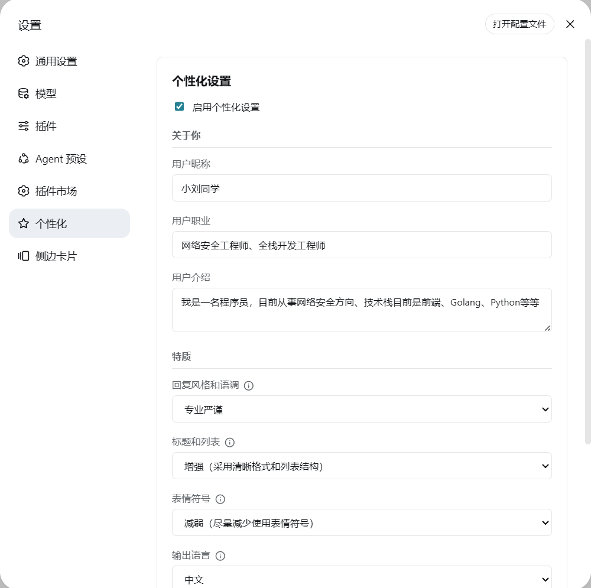
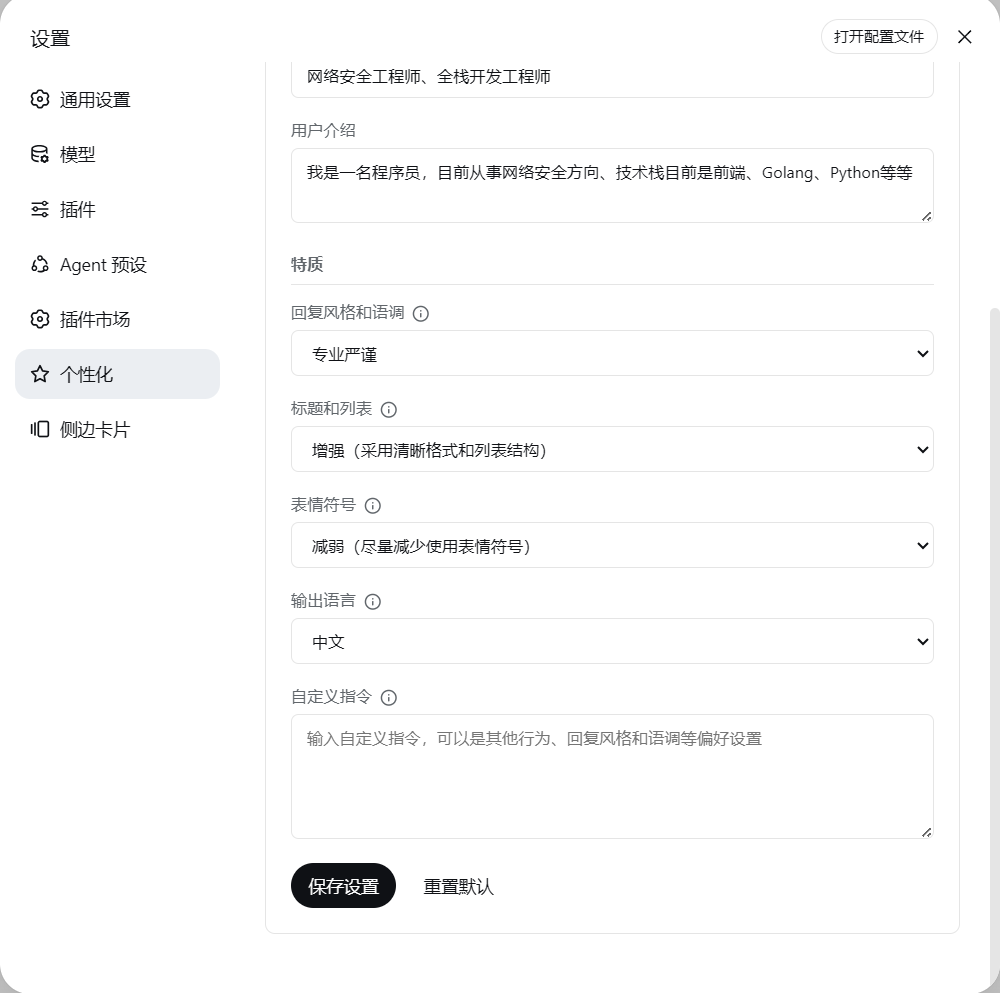

# dsh-soul

[简体中文](./README.md) | [English](./README_EN.md)

[](https://dsh-plugin.org/plugins/aliuyanfeng/dsh-soul)

DeepSeek Harness 个性化设置插件，用于配置 Agent 的昵称、回复风格、语调和自定义指令。

## 功能

- Web UI 个性化设置页面
- 设置页体验：中英双语文案（随界面语言切换）、dirty 检测（无改动禁用保存）、保存结果提示、提示词预览只读面板
- 启用或禁用个性化设置
- 「关于你」：设置用户昵称、职业和介绍，回复时结合你的背景
- 选择回复风格和语调（合并为单一选项）：`professional`（专业严谨）、`casual`（轻松自然）、`humorous`（幽默风趣）、`roast`（吐槽达人）、`efficient`（高效干练）
- 特质微调（在风格和语调的基础上叠加）：
  - 标题和列表：`default`（默认）、`more`（增强，采用清晰格式和列表结构）、`less`（减弱，使用更多段落文本）
  - 表情符号：`default`（默认）、`more`（增强，使用较多表情符号）、`less`（减弱，尽量减少使用表情符号）
  - 表格：`default`（默认）、`more`（增强，呈现对比或多字段信息时优先使用表格）、`less`（减弱，避免表格、改用列表或段落）
- 回复长度偏好：`concise`（简洁，只讲要点、不展开）、`normal`（适中，不额外约束，默认）、`detailed`（详尽，充分展开背景、步骤与推理）
- 选择输出语言（Agent 回复语言 + `/soul` 命令输出语言）：中文 / English
- 提示词随输出语言本地化：`language=en` 时 system prompt 使用英文描述
- 输入自定义指令
- Agent 可调用工具 `set_persona`，让模型在对话中直接调整人设
- 人设预设：7 个内置人设（苏格拉底式提问者 / 极简主义者 / 资深架构师 / 教学型讲解者 / 严格代码审阅者 / 头脑风暴伙伴 / 自驱型协作者，随插件提供、不可删除）+ 多套自建人设一键切换（保存 / 使用 / 列表 / 删除，Web UI 与命令双入口）；每行摘要显示风格与偏离默认的维度
- 预设只管 Agent 的人格：**切换预设不会动「关于你」**（昵称 / 职业 / 介绍是你本人的资料，与「Agent 怎么说话」是两码事）。内置与自建一视同仁——保存预设时只快照风格 / 特质 / 回复长度 / 输出语言 / 自定义指令，不包含身份字段；早期版本存下的完整快照会在读取时自动剥离
- `set_persona` 确认模式（`requireToolConfirmation`）：Agent 的人设修改先在输入框处弹出**宿主原生审批面板**，由你点「允许一次」或「拒绝」（`Enter` 允许 / `Esc` 拒绝）后才会生效；审批通道不可用时（如会话审批策略为 `never`）退化为待确认提议，需 `/soul confirm` 处理
- 输入框光轨：Agent 回复中时，输入框边框显示沿边循环流动的光轨（默认颜色 `#679EFE`）
  - 颜色：预设色板、取色器或十六进制输入（如 `#679EFE`）
  - 流动速度：慢 / 中 / 快；光带粗细：细 / 中 / 粗
  - 光轨起点、终点沿边框匀速推进，带渐隐拖尾；与输入框边框完全重合，不出现双线
  - 设置页内置实时效果示例，随颜色 / 速度 / 粗细联动；系统开启「减少动态效果」时自动停用
- `/soul set` 键值方式修改配置项
- 配置持久化保存
- 配置输入校验：字段白名单、类型、长度上限（昵称/职业 50、介绍 500、自定义指令 2000 字符）、枚举与十六进制颜色校验，非法或超限字段整单拒绝
- 配置持久化健壮性：写入为**原子替换**（先写临时文件再 `rename`，中断不会留下半份配置）；读取区分「文件不存在」与「文件损坏」——损坏时保留原文件、另存 `.corrupt` 备份、**拒绝覆写**，并把原因直接显示在设置页，避免自定义指令与人设库被静默清空
- 配置损坏时有**逃生口**：「重置」会先把损坏文件移开（备份为 `.corrupt`）再写入默认值 —— 否则损坏状态下五条写路径全被拒，用户只能自己删文件
- 送达可观测：`/soul show` 的「送达」行、`GET /api/soul/status`、设置页提示条（`configError` = 配置读不出来；`deliveryWarning` = 配置送不到活动会话）
- 提示词插值已关闭：自定义指令里的 `{{…}}` 按字面保留，不会触发宿主提示词装配失败
- 配置更新后同步到所有活动 Agent
- 变更检测：仅在影响 Agent 行为的配置实际变化时刷新提示词并注入会话；纯外观配置（输入框光轨）只落盘，不产生注入消息
- 变更记录与回滚（**插件详情页**：插件管理 → 已安装插件 → dsh-soul；设置页只在「人设预设」展开区给出指引，保留条数下拉也在这个区块内）：每次配置改动都追加一条记录（时间、**来源**、字段级 `原值 → 新值`），可**撤销某一次改动及其之后的全部改动**；删掉的预设可单点恢复。记录写在 `$DSH_HOME/soul-config.history.jsonl`（追加式，一行一条，人能直接读），保留条数可调（50 / 100 / 200 / 500，默认 200，改完即时生效）；存不下时**只影响记录、不影响配置写入**，并如实告诉你「记录可能不完整」。详情页给时间线与撤销，也可直接看文件
- 插件图标：插件管理列表与侧栏入口显示专属图标（`assets/icon.svg`，36×36，随 npm 包发布）
- 设置导航图标：设置面板左侧「个性化」那一项显示与插件图标同一套几何的图标——同一条光轨与火花，颜色与线宽则跟随邻居（单色 `currentColor`）；DSH 的导航图标按 section id 硬编码、插件声明不了，故由客户端做 DOM 替换
- 提示词预览（只读，设置页底部折叠区）：无未保存编辑时显示**当前生效**的提示词；表单一有改动就转为预览**草稿**——展示保存后真正会注入的内容，边改边看（停止输入 400ms 后自动重新编译），并在保存 / 重置 / 应用预设后自动刷新。未通过校验的字段会单独列出且不计入预览

## 路线图

| 版本 | 方向 | 状态 |
| --- | --- | --- |
| `0.7.2` | 设置页样式对齐宿主、卡片堆叠轮播、人设变更走宿主原生审批面板 | 已发布 |
| `0.8.0` | **变更审计与回滚** —— 记录每次配置改动（时间戳、来源、字段级 from→to），插件详情页给时间线与撤销（设置页只留去向指引） | [设计文档](./DESIGN-audit-rollback.md) 已完成 |
| `0.9.0` | **三级隔离** —— Global → Workspace → Session，工作区决定人设、会话可临时覆盖 | [设计文档](./DESIGN-persona-scope.md) 设计完成待实现 |
| `0.8.2` | 自演化提议 + diff 审批 —— Agent 提议精炼人设，改动以 diff 走审批面板 | 规划中 |
| `0.9.0` | 记忆层 —— 跨会话长期记忆，按人设隔离、按需召回 | 规划中 |

设计与取舍写在对应的设计文档里；已发布的改动见 [RELEASE_NOTES.md](./RELEASE_NOTES.md)，发版流程见 [PUBLISHING.md](./PUBLISHING.md)。路线图是方向而非承诺，顺序可能调整。

## 安装

```powershell
dsh plugin --profile <profile> add dsh-soul
dsh plugin --profile <profile> update dsh-soul
```

插件配置由 `cordis.patch.yml` 提供：

```yaml
- insert:
    - id: soul
      name: dsh-soul
```

## 兼容性

插件不打包 DSH 运行时包，全部由宿主提供。DSH 会在装载前校验 `peerDependencies`，**比较对象是 DSH 运行时版本**（`@deepseek-ai/dsh-app-boot` 的 version），而不是这些包各自的版本：

| 包 | 范围 |
| --- | --- |
| `@deepseek-ai/dsh-llm` | `>=0.1.1-rc.2 <0.3.0-0` |
| `@deepseek-ai/dsh-tools` | `>=0.1.0-rc.6 <0.3.0-0` |
| `@deepseek-ai/cordis` | `^4.0.1 \|\| ^4.0.5-alpha.1` |

即支持 DSH **0.1.x 与 0.2.x**（含 prerelease 版本）。可用 `npm run verify:compat` 在当前环境确认声明是否成立。

若 DSH 提示「dsh-soul@x.y.z 与 DSH a.b.c 不兼容」，说明插件版本早于该 DSH 版本，升级插件即可：

```powershell
dsh plugin --profile <profile> update dsh-soul
```

## 截图

**设置页（关于你 + 特质）**



**设置页（特质 + 输出语言 + 自定义指令）**



**`/soul` 命令提示**


**`/soul` 命令输出（设置昵称、show、enable、disable、reset）**


## 使用

启动 DSH 后，进入设置页面中的「个性化设置」栏目，修改配置并点击「保存设置」。

也可以使用斜杠命令：

```text
/soul show        查看当前配置（含确认模式、预设数量与送达状态）
/soul set k=v     修改配置项（如 /soul set style=humorous language=en；光轨：trailColor=#679EFE trailSpeed=fast trailWidth=thick）
/soul save <名>   保存当前人设为预设（只含人格维度，不含「关于你」；内置名不可占用）
/soul use <名>    应用人设预设（内置预设同样可用）
/soul list        查看人设预设（✔ 标记当前匹配项；内置项带 [内置] 标记）
/soul del <名>    删除人设预设（delete / rm 别名；内置预设不可删）
/soul confirm     应用待确认的人设变更（确认模式）
/soul reject      拒绝待确认的人设变更
/soul reset       重置配置（保留人设预设库）；配置损坏时这是逃生口，会先备份为 .corrupt
/soul enable      启用个性化设置
/soul disable     禁用个性化设置
/soul 小明        设置昵称
```

配置保存后会同步到所有活动 Agent，当前会话下一次请求即可使用最新配置；无实际变化的保存不产生注入消息。

Agent 也可以通过工具 `set_persona` 在对话中直接调整你的人设（昵称、回复风格和语调、特质、回复语言、自定义指令）。模型只会在明确请求改变称呼、语气、风格或语言时调用该工具。开启「人设变更需确认」（`requireToolConfirmation`）后，该工具的修改会先在输入框处弹出**宿主原生审批面板**（与沙箱提权、模型切换用的是同一套交互），由你点「允许一次」或「拒绝」——`Enter` 允许、`Esc` 拒绝，改动会写入会话审计日志。审批通道不可用时（例如会话审批策略为 `never`、或没有可用的 Web UI 应答者）则退化为待确认提议，需 `/soul confirm` 确认或 `/soul reject` 拒绝。若你处在完全权限的会话中（审批策略 `never`），面板不会出现、每次变更都要手动输入命令，此时建议关闭该开关。

## 配置文件

插件将配置保存到 DSH 的用户数据目录，文件名为：

```text
soul-config.json
```

配置示例：

```json
{
  "enabled": true,
  "nickname": "小明",
  "occupation": "软件工程师",
  "bio": "对编程和技术感兴趣",
  "style": "professional",
  "language": "zh",
  "customInstructions": "请保持简洁，优先给出结论。",
  "requireToolConfirmation": false,
  "trailEnabled": true,
  "trailColor": "#679EFE",
  "trailSpeed": "slow",
  "trailWidth": "thin"
}
```

自建人设预设保存在同一文件的 `personas` 字段：名称 → 人设字段快照（风格 / 特质 / 回复长度 / 输出语言 / 自定义指令）+ `updatedAt`。**预设不含「关于你」**（昵称 / 职业 / 介绍）——那是使用者本人的资料，切换预设只换 Agent 的说话方式；这条由 `PROFILE_FIELDS` 与 `PERSONA_FIELDS`（`lib/config.mjs`）结构性保证：保存快照、应用取键、★ 匹配判据、磁盘归一化四条路径都按 `PERSONA_FIELDS` 白名单走，所以内置与自建行为一致。预设库变更不影响活动配置，使用预设时才应用到配置并同步会话。内置人设不落盘（见 `lib/personas.mjs`），列表 / 使用 / ★ 匹配统一走「内置 + 自建」的合并视图，同名以内置为准，内置名既不可保存占用也不可删除。

输入框光轨字段：`trailEnabled`（是否启用，默认 `true`）、`trailColor`（6 位十六进制颜色，统一大写存储，默认 `#679EFE`）、`trailSpeed`（`slow` / `normal` / `fast`，默认 `slow`）、`trailWidth`（`thin` / `normal` / `thick`，默认 `thin`）。这四个字段属纯外观配置，只落盘、不进入 system prompt、不触发会话注入。

字段长度上限：昵称 / 职业 50 字符，介绍 500 字符，自定义指令 2000 字符；颜色必须为 `#rrggbb` 形式。未知字段会被丢弃，非法或超限字段整单拒绝（HTTP 返回 400 与字段级错误明细）。

## 实现原理

「保存后下一次请求即生效」由**两条通道**共同保证（缺一不可，见 `DEBUGGING.md` 3.5）。

**通道一：system prompt section。** 插件把配置编译成 system prompt 并注册到 DSH：

```js
spCtx.systemPrompt.section({
  name: 'soul:persona',
  order: 0,
  // 关闭宿主提示词插值：默认开启时，用户自定义指令里任何一对完整的 {{…}}
  // 都会让装配抛错（该抛错在 agent.step() 开头且无 try/catch ⇒ 每轮都失败）
  interpolate: false,
  text: () => compilePrompt(configCache || DEFAULT_CONFIG)
})
```

宿主在**每一个 step 之前**都会重新装配提示词，对函数式 `text` provider **不做缓存**，并在文本变化时自行提交新的 system 快照 —— 所以这一条的更新时机是「下一次请求」。

**通道二：活动会话注入。** 配置变化后，插件遍历所有活动 Agent，用标准 `UserMessage` 调用 `agent.inject()`：

```js
agent.inject(createUserMessage({
  content: [{ type: 'text', text: `[dsh-soul 个性化配置已更新]\n…\n${prompt}` }],
  // 会话格式 v4 要求生产者自持 kind（不得再用共享的 kind:'plugin' + plugin 字段，
  // 那会让每一轮在 step 开始前失败）；构造见 lib/injection.mjs
  source: { kind: 'plugin:dsh-soul', form: 'snapshot', sections: [{ name: 'soul:persona', text: prompt }] }
}))
```

`agent.inject()` 会把最新配置放入 Agent 的待处理上下文，在下一次请求中生效；不会主动触发新请求，也不会修改历史消息。它同时是「即时生效」的可见载体：会话里会出现一条 `[dsh-soul 个性化配置已更新]` 消息。

> 为什么两条都要：**只保留通道一时，实测「会话进行中修改人设」不会在下一轮生效**（0.7.1 开发中曾据此删除通道二，随后原样撤回）。`npm run verify:host` 与 `npm run verify:e2e` 分别把两条通道钉住，DSH 升级后请重跑。

**诊断。** 这两条通道静默失效时症状都是「改了配置不生效」，因此插件会如实记录送达结果：`/soul show` 末尾的「送达」行、`GET /api/soul/status`、以及设置页的提示条（`configError` = 配置读不出来，`deliveryWarning` = 配置送不到活动会话）。

## 许可证

MIT License，完整文本见 [LICENSE](LICENSE)。
